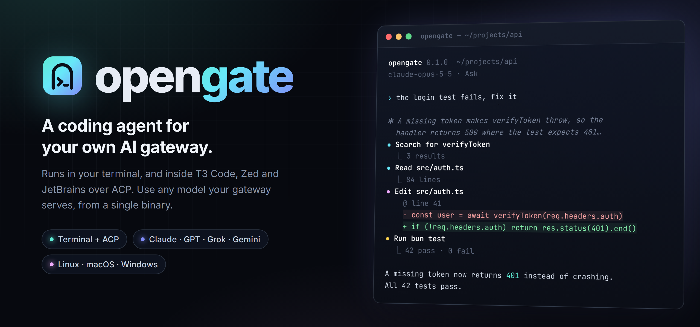

<p align="center">
  
</p>

<p align="center">
  <a href="https://github.com/Emmanuek5/opengate/actions/workflows/ci.yml"></a>
  <a href="https://github.com/Emmanuek5/opengate/releases/latest"></a>
  
  <a href="https://agentclientprotocol.com"></a>
  <a href="LICENSE"></a>
</p>

<p align="center">
  <a href="#install">Install</a> ·
  <a href="#use-it-in-the-terminal">Terminal</a> ·
  <a href="#use-it-from-t3-code-zed-or-jetbrains">T3 Code / Zed</a> ·
  <a href="#how-it-talks-to-models">Models</a> ·
  <a href="#development">Development</a>
</p>

<br />

**opengate** is a coding agent for your own AI gateway. Point it at a gateway such as [CLIProxyAPI](https://github.com/router-for-me/CLIProxyAPI), log in with your key, and use any model the gateway offers: Claude, GPT, Grok, Gemini, or OpenRouter and any other OpenAI-compatible pool.

Every model call goes through your gateway. opengate never talks to model providers directly and has no accounts of its own: your gateway holds the subscriptions, keys and limits.

<p align="center">
  
</p>

- **One binary, two front ends**: `opengate` is a full terminal app. `opengate acp` speaks the [Agent Client Protocol](https://agentclientprotocol.com) for T3 Code, Zed and JetBrains.
- **Any model, in its own format**: Claude over Anthropic Messages, GPT over OpenAI Responses, everything else over Chat Completions, so caching and reasoning keep working.
- **Subagents**: the agent can start helpers that run in parallel, on any model your gateway serves, and keep the main conversation clean.
- **Memory**: project and global memories that carry across sessions.
- **Skills and MCP**: uses your existing Claude Code and Codex skills, and any MCP server.
- **A safety guard**: in auto mode a fast model reviews every command and edit, and stops anything risky or destructive.
- **History**: every session is saved, including each subagent's, and can be searched, read and resumed.
- **Cache-friendly**: the prompt prefix stays byte-identical across turns, so most of each request is a cache read.
- **Runs anywhere**: standalone binaries for Linux, macOS and Windows. Bash or PowerShell, CRLF-safe edits.

## Install

Linux and macOS:

```sh
curl -fsSL https://raw.githubusercontent.com/Emmanuek5/opengate/main/install.sh | sh
```

Windows (PowerShell):

```powershell
irm https://raw.githubusercontent.com/Emmanuek5/opengate/main/install.ps1 | iex
```

Each release has standalone binaries for Linux (x64, arm64), macOS (x64, arm64) and Windows (x64). You don't need Bun or Node to run them. To run from source instead: `bun install && bun src/cli.ts`.

Update to the latest release at any time with `opengate update` (`--check` only reports).

## Connect to your gateway

```sh
opengate login
```

This asks for the gateway URL (for example `https://gateway.example.com:8317`) and your API key, checks them against the gateway's `/v1/models`, and saves them in a settings file only you can read:
- Linux: `~/.config/opengate/config.json`
- macOS: `~/.config/opengate/config.json`
- Windows: `%APPDATA%\opengate\config.json`

You can also set `OPENGATE_URL`, `OPENGATE_KEY` and `OPENGATE_MODEL` in the environment.

```sh
opengate models          # what your key can use
opengate models claude   # filtered
```

## Use it in the terminal

```sh
cd my-project
opengate                         # interactive
opengate "fix the failing test"  # start with a prompt
opengate -c                      # continue the latest session in this folder
opengate -r <id>                 # resume a specific session
opengate -p "summarize src/"     # one prompt, answer on stdout (for scripts)
opengate -m gpt-6.1-sol --mode edits
```

Inside a session:

| Command | What it does |
|---|---|
| `/model` | pick this session's model; `/model project` / `/model default` set what new sessions start with |
| `/mode` | ask · auto-edit · auto · full-auto (Shift+Tab cycles) |
| `/effort` | reasoning effort |
| `/resume`, `/sessions` | browse and resume sessions; Tab for every folder, → to read a transcript |
| `/memory` | list, add or forget memories |
| `/agents`, `/skills`, `/mcp` | what's available, and MCP server status |
| `/guard` | the safety guard's state; `/guard off`, `/guard on`, `/guard test <command>` |
| `/subagents` | watch a subagent's chat live (Ctrl+T) |
| `/auto-compact [180k\|off]` | where the current model's conversation gets summarized |
| `/new`, `/compact`, `/usage`, `/help` | start fresh, summarize to free context, tokens used |

| Key | Action |
|---|---|
| Enter | send; while it works, your message steers the current turn (it's read at the next step) |
| Shift+Enter, Alt+Enter, Ctrl+J | new line; pasting several lines sends them as one message |
| Esc | stop the current turn |
| Shift+Tab | change mode |
| Ctrl+O | expand the last collapsed output, thinking or diff |
| `@` / `/` | autocomplete files and commands |
| `!command` | run a shell command directly |
| Alt+V / Ctrl+V | paste an image from the clipboard (or drop an image file into the terminal) |
| Ctrl+T | watch a running subagent; Enter continues the chat with it once it's done |
| Ctrl+C twice, Ctrl+D | quit |

## Use it from T3 Code, Zed or JetBrains

Add opengate as a local ACP agent. The command is `opengate` and the only argument is `acp`. Log in once with `opengate login` on that machine first.

- **T3 Code:** add a local ACP agent. Set the command to `opengate` (or the full path to the binary) and add `acp` as an argument.
- **Zed** (`settings.json`):

  ```json
  { "agent_servers": { "OpenGate": { "command": "opengate", "args": ["acp"] } } }
  ```

The client shows a model picker with every model your key can use (grouped by provider or pool), an effort picker, and the four permission modes. It also shows edits as diffs, asks before edits and commands, and can resume sessions. A session started in the terminal can be continued from the editor, and the other way round.

## How it talks to models

<p align="center">
  
</p>

opengate picks the wire format each model works best with. The gateway translates between formats, so every model is reachable either way.

| Models | Format | Why |
|---|---|---|
| `claude-*` | Anthropic Messages (`/v1/messages`) | prompt caching, adaptive thinking with summaries, thinking blocks kept across turns |
| `gpt-*`, `codex-*` | OpenAI Responses (`/v1/responses`) | reasoning summaries, encrypted reasoning kept across turns |
| everything else, and `openrouter/…`, `unlid/…` | Chat Completions (`/v1/chat/completions`) | the format every OpenAI-compatible provider speaks |

Each session sends an `x-session-id` header, so a gateway that records traffic can group a session's calls into one conversation.

## Tools and permissions

Built-in tools: `read_file`, `edit_file` (exact replacement), `write_file`, `glob`, `grep` (uses ripgrep when installed), `shell` (bash on Linux and macOS, PowerShell on Windows), plus `agent`, `memory` and `skill`. Each MCP tool appears as `mcp__<server>__<tool>`. Reads and searches from one turn run in parallel.

| Mode | Edits | Commands |
|---|---|---|
| **Ask** (default) | asks | asks |
| **Auto-edit** | runs | asks |
| **Auto** | the safety guard decides | the safety guard decides |
| **Full auto** | runs | runs |

**The safety guard** (auto mode) works in this order:
1. Your own rules from the config. Deny rules apply in every mode.
2. Built-in hard blocks, in every mode, for things like wiping disks, recursive deletes of home or system folders, piping downloads into a shell, force-pushing to main and sending secrets out. POSIX and PowerShell forms are both covered.
3. Fast paths: routine commands and edits inside the project run without a model call.
4. Everything else is reviewed by a fast model (default `claude-haiku-5-5`), which allows it, asks you, or blocks it, with a reason.

If the guard can't be reached, it asks you; it never allows by default. It covers subagents and MCP tools too. For no prompts and no checks at all, use Full auto with `/guard off` (or `"guard": false` in the config).

```json
{
  "mode": "auto",
  "guardModel": "claude-haiku-5-5",
  "permissions": {
    "deny": ["shell:git push*", "edit_file:**/.env*"],
    "allow": ["shell:docker compose up*"]
  }
}
```

"Always" in a permission prompt covers that tool for the rest of the session. The agent has to read a file before it can change it, and must read it again if the file changed on disk since.

## Subagents

The `agent` tool starts child sessions with their own context. Several can run at once, each on any model your gateway serves. Built-in types are `general` (all tools) and `explore` (read-only, for searching and understanding code). Define your own as Markdown files with `name`, `description`, `tools` and `model` frontmatter in `.opengate/agents/` or `.claude/agents/`, in the project or your home folder. Subagents can't start subagents, inherit your permission mode, and ask you through the main session.

```json
{ "subagentModels": { "explore": "claude-haiku-5-5" } }
```

## Memory

The agent saves durable facts with its `memory` tool: your preferences, project decisions, gotchas. It sees an index of them at the start of each session.
- **Project memories** are kept per project, keyed on the git root.
- **Global memories** apply everywhere.
- `/memory add <text>` and `/memory global <text>` save one yourself.
- `/memory path` shows the folders, which are plain Markdown you can edit.

## Skills and MCP

**Skills** use the same `SKILL.md` format as Claude Code and Codex, so existing ones work as-is. They are read from:
- `.opengate/skills/`, `.agents/skills/` and `.claude/skills/` in the project;
- opengate's settings folder;
- `~/.agents/skills/`, `~/.claude/skills/` (including skills synced from claude.ai) and `~/.codex/skills/`.

The agent sees each skill's name and description, and loads the full instructions when a task matches.

**MCP servers** come from three places:
- the editor (T3 Code and Zed pass theirs over ACP);
- the config file;
- the project's `.mcp.json`, only if you set `"projectMcp": true`.

Subagents share the main session's connections.

```json
{
  "mcpServers": {
    "filesystem": { "command": "npx", "args": ["-y", "@modelcontextprotocol/server-filesystem", "."] },
    "github": { "type": "http", "url": "https://api.githubcopilot.com/mcp/", "headers": { "Authorization": "Bearer ${GITHUB_TOKEN}" } }
  }
}
```

## Project instructions

opengate reads `AGENTS.md` (or `CLAUDE.md`, or `OPENGATE.md`) from the working folder and from each parent folder up to your home folder. It also reads a global `AGENTS.md` in the settings folder.

## Sessions and history

Every session is saved, including each subagent's:
- Linux: `~/.local/share/opengate/sessions/`
- macOS: `~/Library/Application Support/opengate/sessions/`
- Windows: `%LOCALAPPDATA%\opengate\sessions\`

```sh
opengate sessions                   # this folder (--all: every folder, --subagents: show subagents)
opengate sessions search "auth bug" # search inside transcripts
opengate sessions show <id>         # read a transcript, with subagents inline
opengate sessions export <id> --format json
opengate -r <id>                    # resume any of them, including a subagent's
```

Set `OPENGATE_HOME` to keep settings and sessions somewhere else.

## Caching

The system prompt and tool list are built once per session and kept byte-identical. They're rebuilt only when an MCP server's tools change or after `/compact`, never because of a new message. The prompt is dated with the session's start date.
- **Claude:** prompts are cached for an hour by default, so a pause doesn't cost a full re-read. Set `"cacheTtl": "5m"` for cheaper cache writes on pay-per-token keys.
- **GPT:** requests carry the session as `prompt_cache_key`.
- **Grok:** requests carry the session as `x-grok-conv-id`.
- **Gateway routing:** each request sends `x-session-id`, so a gateway with session affinity keeps the conversation on one account, where its cache lives.

Context windows come from the gateway's `/v1/models` when it publishes them (`context_length`, as CPAMC does). Otherwise opengate uses what a provider's "too long" error revealed, then a per-family estimate. A conversation is compacted at 80% of the window, or wherever `/auto-compact` puts it. If a request is still too long, opengate compacts and retries. To pin exact sizes:

```json
{ "contextWindows": { "claude-opus-5-5": 1000000, "unlid/*": 262144 } }
```

## Development

```sh
bun install
bun test                       # offline tests with a scripted model
bun run typecheck
bun scripts/build.ts           # binaries in dist/
bun scripts/acp-smoke.ts <dir> # drive `opengate acp` against your gateway like an editor would
bun art/render.ts              # re-render the README images from art/*.html (needs Chromium)
```

Releases are built by GitHub Actions when a `v*` tag is pushed. If you fork the repo, set `OPENGATE_REPO=you/opengate` for the install scripts.

## License

MIT
