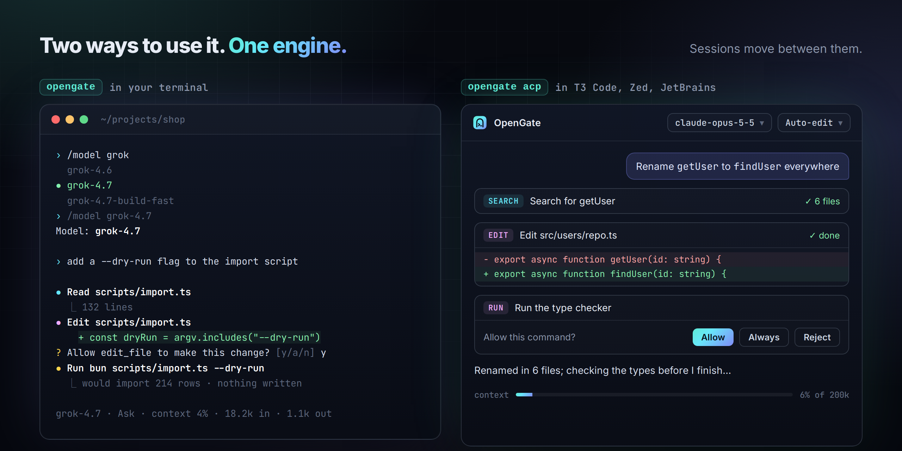
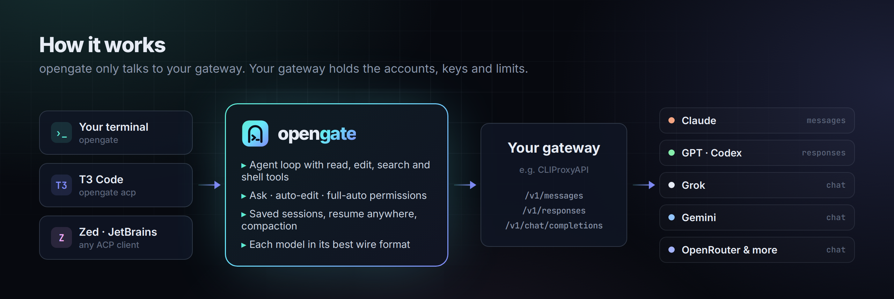

<p align="center">
  
</p>

<p align="center">
  <a href="https://github.com/Emmanuek5/opengate/actions/workflows/ci.yml"></a>
  <a href="https://github.com/Emmanuek5/opengate/releases/latest"></a>
  
  <a href="https://agentclientprotocol.com"></a>
  <a href="LICENSE"></a>
</p>

<p align="center">
  <a href="#install">Install</a> ·
  <a href="#use-it-in-the-terminal">Terminal</a> ·
  <a href="#use-it-from-t3-code-zed-or-jetbrains">T3 Code / Zed</a> ·
  <a href="#how-it-talks-to-models">Models</a> ·
  <a href="#development">Development</a>
</p>

<br />

**opengate** is a coding agent for your own AI gateway. Point it at a gateway such as [CLIProxyAPI](https://github.com/router-for-me/CLIProxyAPI), log in with your key, and use any model the gateway offers: Claude, GPT, Grok, Gemini, or OpenRouter and any other OpenAI-compatible pool.

Every model call goes through your gateway. opengate never talks to model providers directly and has no accounts of its own: your gateway holds the subscriptions, keys and limits.

<p align="center">
  
</p>

- **One binary, two front ends**: `opengate` is an interactive terminal agent. `opengate acp` speaks the [Agent Client Protocol](https://agentclientprotocol.com) for T3 Code, Zed and JetBrains.
- **Any model, in its own format**: Claude over Anthropic Messages, GPT over OpenAI Responses, everything else over Chat Completions, so caching and reasoning keep working.
- **You stay in control**: Ask, auto-edit or full-auto permissions. Edits show up as diffs before they land.
- **Sessions that follow you**: Saved on disk, resumable from the terminal or the editor, compacted automatically when the context fills up.
- **Runs anywhere**: Standalone binaries for Linux, macOS and Windows. Bash or PowerShell, CRLF-safe edits.

## Install

Linux and macOS:

```sh
curl -fsSL https://raw.githubusercontent.com/Emmanuek5/opengate/main/install.sh | sh
```

Windows (PowerShell):

```powershell
irm https://raw.githubusercontent.com/Emmanuek5/opengate/main/install.ps1 | iex
```

Each release has standalone binaries for Linux (x64, arm64), macOS (x64, arm64) and Windows (x64). You don't need Bun or Node to run them. To run from source instead: `bun install && bun src/cli.ts`.

## Connect to your gateway

```sh
opengate login
```

This asks for the gateway URL (for example `https://gateway.example.com:8317`) and your API key, checks them against the gateway's `/v1/models`, and saves them in a settings file only you can read:
- Linux: `~/.config/opengate/config.json`
- macOS: `~/.config/opengate/config.json`
- Windows: `%APPDATA%\opengate\config.json`

You can also set `OPENGATE_URL`, `OPENGATE_KEY` and `OPENGATE_MODEL` in the environment.

```sh
opengate models          # what your key can use
opengate models claude   # filtered
```

## Use it in the terminal

```sh
cd my-project
opengate                         # interactive
opengate "fix the failing test"  # start with a prompt
opengate -c                      # continue the latest session in this folder
opengate -r <id>                 # resume a specific session
opengate -p "summarize src/"     # one prompt, answer on stdout (for scripts)
opengate -m gpt-6.1-sol --mode edits
```

Inside a session:

| Command | What it does |
|---|---|
| `/model [name]` | list models, or switch (partial names work) |
| `/mode [ask\|edits\|auto]` | when to ask before edits and commands (Shift+Tab cycles) |
| `/effort [auto\|low\|medium\|high\|xhigh\|max]` | reasoning effort |
| `/sessions`, `/resume [n]` | saved sessions in this folder |
| `/new` | start fresh |
| `/compact` | summarize the conversation to free up context |
| `/usage` | tokens used so far |

Ctrl+C stops the current turn, and Ctrl+D quits. End a line with `\` to keep typing on the next line; pasted text with several lines is sent as one message.

## Use it from T3 Code, Zed or JetBrains

Add opengate as a local ACP agent. The command is `opengate` and the only argument is `acp`. Log in once with `opengate login` on that machine first.

- **T3 Code:** add a local ACP agent. Set the command to `opengate` (or the full path to the binary) and add `acp` as an argument.
- **Zed** (`settings.json`):

  ```json
  { "agent_servers": { "OpenGate": { "command": "opengate", "args": ["acp"] } } }
  ```

The client shows a model picker with every model your key can use (grouped by provider or pool), an effort picker, and the three permission modes. It also shows edits as diffs, asks before edits and commands, and can resume sessions. A session started in the terminal can be continued from the editor, and the other way round.

## How it talks to models

<p align="center">
  
</p>

opengate picks the wire format each model works best with. The gateway translates between formats, so every model is reachable either way.

| Models | Format | Why |
|---|---|---|
| `claude-*` | Anthropic Messages (`/v1/messages`) | prompt caching, adaptive thinking with summaries, thinking blocks kept across turns |
| `gpt-*`, `codex-*` | OpenAI Responses (`/v1/responses`) | reasoning summaries, encrypted reasoning kept across turns |
| everything else, and `openrouter/…`, `unlid/…` | Chat Completions (`/v1/chat/completions`) | the format every OpenAI-compatible provider speaks |

Each session sends an `x-session-id` header, so a gateway that records traffic can group a session's calls into one conversation.

## Tools and permissions

The agent has `read_file`, `edit_file` (exact replacement), `write_file`, `glob`, `grep` (uses ripgrep when it's installed) and `shell`. The shell is bash on Linux and macOS, and PowerShell on Windows.

- **Ask** (default): asks before every edit and command.
- **Auto-edit**: edits without asking; asks before commands.
- **Full auto**: never asks.

"Always" in a permission prompt covers that tool for the rest of the session. The agent has to read a file before it can change it, and must read it again if the file changed on disk since.

## Project instructions

opengate reads `AGENTS.md` (or `CLAUDE.md`, or `OPENGATE.md`) from the working folder and from each parent folder up to your home folder. It also reads a global `AGENTS.md` in the settings folder.

## Sessions

Sessions are saved as JSON files:
- Linux: `~/.local/share/opengate/sessions/`
- macOS: `~/Library/Application Support/opengate/sessions/`
- Windows: `%LOCALAPPDATA%\opengate\sessions\`

Set `OPENGATE_HOME` to keep settings and sessions somewhere else.

Context windows are estimated per model family, and a conversation is compacted automatically when it nears the limit. To set exact sizes, add them to the config file:

```json
{ "contextWindows": { "claude-opus-5-5": 1000000, "unlid/*": 262144 } }
```

## Development

```sh
bun install
bun test                       # offline tests with a scripted model
bun run typecheck
bun scripts/build.ts           # binaries in dist/
bun scripts/acp-smoke.ts <dir> # drive `opengate acp` against your gateway like an editor would
bun art/render.ts              # re-render the README images from art/*.html (needs Chromium)
```

Releases are built by GitHub Actions when a `v*` tag is pushed. If you fork the repo, set `OPENGATE_REPO=you/opengate` for the install scripts.

## License

MIT
